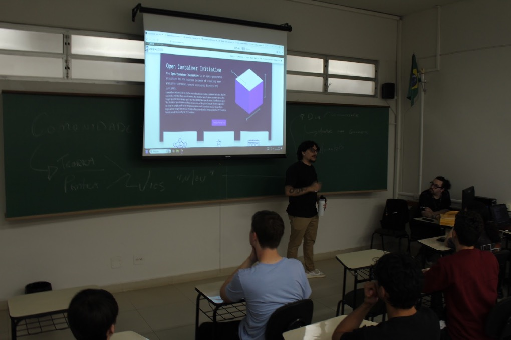

## Sobre o Evento

- **Nome**: WorkInTech 2026 — Workshop 07 · "The Science Behind Communities"
- **Data**: 26–27/10/2026 (workshops; hackathon de 28–30/10)
- **Local / Sede**: UniCesumar — Bloco 7, Sala 36
- **Cidade / País**: Maringá / Brasil
- **Organizador**: WorkInTech / UniCesumar
- **Link**: https://www.workintech.com.br/workshops/science-behind-communities

## Palestras Apresentadas

- *The Science Behind Communities* — Speaker: Enderson Menezes (26–27/10, Bloco 7 — Sala 36)
  - Descrição do workshop: "O palestrante abordará o Open Source como um modelo de produção colaborativa que transforma a maneira como a tecnologia é desenvolvida e compartilhada. Além disso, apresentará os fundamentos desse movimento e práticas de contribuição em projetos de código aberto por meio do GitHub."

## Programação / Trilhas
<!-- Palestras ou sessões que assistiu, com speaker quando relevante -->

## Materiais e Fotos
<!-- Preferir links relativos para imagens em assets/ -->
- Slides:
- Fotos:
  - 

## Publicações
- [Post no LinkedIn — Enderson Menezes](https://lnkd.in/p/d4S2CNzK)
- [Post no Instagram](https://www.instagram.com/p/DfiO7iemS_p/)

## Observações

- Conteúdo derivado da talk base [GitHub e Comunidade Open Source](../presentations/talk_github_and_open_source_community.md), adaptado para o formato de workshop (45 vagas) da WorkInTech 2026.
- WorkInTech 2026: semana inteira na UniCesumar — workshops nos dias 26 e 27/10 e hackathon de 28 a 30/10.
